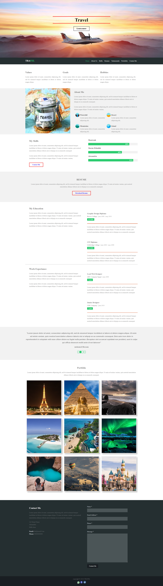

# 🌍 Travel Website

## 📌 About the Project

A travel-themed website built using HTML and CSS as part of my front-end development learning journey.

This project focuses on practicing website layouts, styling, navigation, and visual design.

## 🚀 Live Demo

[Visit the Website](https://mohamedhossam107.github.io/travel-website/)

## ✨ Features

- Travel-themed landing page
- Navigation bar
- Destination image gallery
- CSS progress bars
- Registration page
- Contact form design

## 🛠️ Technologies Used

- HTML5
- CSS3
- Git
- GitHub Pages

## 📂 Project Structure

    travel-website/
    ├── css/
    ├── images/
    ├── index.html
    ├── register.html
    └── README.md

## 🎯 Learning Objectives

- Building structured web pages
- Practicing CSS styling and layouts
- Organizing project files
- Publishing a website using GitHub Pages

## 👨‍💻 Author

**Mohamed Hossam**

[GitHub](https://github.com/MohamedHossam107) | [LinkedIn](https://www.linkedin.com/in/mohamed-hossam-a40169309/)

## 📸 Website Preview

